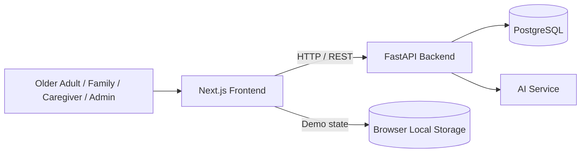

# CareBridge AI

CareBridge AI ek elderly-care coordination platform hai jo older adults, family members, caregivers aur administrators ko ek shared digital workspace me connect karta hai.

Project ka goal daily wellness check-ins, care tasks, AI-assisted summaries, notifications, escalations aur consent-aware data sharing ko simple aur accessible interface ke through manage karna hai.

> CareBridge AI demo/research project hai. Yeh medical diagnosis, emergency response ya professional medical care ka replacement nahi hai. Serious health concern hone par emergency services ya qualified care professional se contact karein.

---

## Table of Contents

- [Key Features](#key-features)
- [Roles and Demo Accounts](#roles-and-demo-accounts)
- [Technology Stack](#technology-stack)
- [System Architecture](#system-architecture)
- [Project Structure](#project-structure)
- [Prerequisites](#prerequisites)
- [Local Development](#local-development)
- [Docker Setup](#docker-setup)
- [Environment Variables](#environment-variables)
- [Available API Endpoints](#available-api-endpoints)
- [Demo Behavior and Persistence](#demo-behavior-and-persistence)
- [Testing](#testing)
- [Production Build](#production-build)
- [Security and Privacy Notes](#security-and-privacy-notes)
- [Troubleshooting](#troubleshooting)
- [Contributing](#contributing)
- [License](#license)

---

## Key Features

### Elderly User Experience

- Personal wellness dashboard
- Daily check-in and health-status submission
- Mood, symptom aur response tracking
- AI-style assistant chat
- Human-assistance request
- Family member ko contact karne ka option
- Notification aur reminders
- Simple, accessible interface

### Family Member Experience

- Elderly loved one's wellness overview
- Check-in history aur status visibility
- Care tasks aur updates dekhna
- Family-level notifications
- Sharing preferences aur consent controls
- CSV report export

### Caregiver Experience

- Assigned care tasks ki list
- Task status update
- Care activity aur patient information review
- Escalation aur notification handling
- Care coordination workflow

### Administrator Experience

- User aur role-based dashboard view
- Platform analytics
- Audit-log visibility
- Escalation monitoring
- Consent records aur system activity tracking

### Backend and AI Features

- FastAPI-based REST API
- SQLAlchemy and PostgreSQL integration
- User registration and login
- Elderly profiles
- Check-ins and caregiver tasks
- Notifications and escalation events
- AI chat and daily summary endpoints
- Audit logging
- Rule-based demo assistant when no external AI key is configured

---

## Roles and Demo Accounts

App login screen par direct demo account use kiya ja sakta hai.

| Role | Name | Email | Password |
|---|---|---|---|
| Elderly User | Mrs. Lin | `elderly@demo.com` | `carebridge123` |
| Family Member | David Lin | `family@demo.com` | `carebridge123` |
| Caregiver | Anna Chen | `caregiver@demo.com` | `carebridge123` |
| Administrator | Admin User | `admin@demo.com` | `carebridge123` |

Demo login frontend local session create karta hai aur corresponding role dashboard open karta hai.

> Demo credentials sirf local demonstration ke liye hain. Real production deployment me secure authentication, password hashing, session management aur role-based authorization required honge.

---

## Technology Stack

### Frontend

- Next.js 14
- React 18
- TypeScript
- Tailwind CSS
- Radix UI
- Lucide React
- Framer Motion
- Recharts
- React Hook Form
- Zod

### Backend

- Python
- FastAPI
- Uvicorn
- SQLAlchemy
- Pydantic
- PostgreSQL
- Argon2 / password utilities
- Pytest

### Infrastructure

- Docker
- Docker Compose
- PostgreSQL 16

---

## System Architecture



Main request flow:

1. User Next.js frontend se sign in karta hai ya demo account select karta hai.
2. Frontend API requests FastAPI backend ko bhejta hai.
3. Backend SQLAlchemy ke through PostgreSQL se data read/write karta hai.
4. AI service chat aur summary ke liye backend endpoint provide karta hai.
5. Demo dashboards ke interaction-heavy parts browser local storage me persist ho sakte hain.

---

## Project Structure

```text
CAREBRIDGE-AI/
├── backend/
│   ├── app/
│   │   ├── main.py          # FastAPI application and API routes
│   │   ├── config.py        # Environment configuration
│   │   ├── db.py            # Database engine and sessions
│   │   ├── models.py        # SQLAlchemy models
│   │   ├── schemas.py       # Pydantic request/response schemas
│   │   └── services/
│   │       └── ai.py        # AI chat and summary service
│   ├── tests/
│   │   └── test_api.py      # Backend API tests
│   ├── Dockerfile
│   └── requirements.txt
├── frontend/
│   ├── app/
│   │   ├── auth/            # Sign-in and registration UI
│   │   ├── dashboard/       # Role-specific dashboards
│   │   ├── layout.tsx
│   │   └── page.tsx         # Landing page
│   ├── components/
│   │   ├── dashboard/       # Dashboard shell and interactions
│   │   └── ui/              # Reusable UI components
│   ├── lib/
│   │   ├── demo-store.ts    # Browser local demo event storage
│   │   └── utils.ts
│   ├── Dockerfile
│   └── package.json
├── docker-compose.yml
├── .env.example
├── package.json
└── README.md
```

---

## Prerequisites

Choose either local development or Docker setup.

### For local development

- Node.js 18 or newer
- npm
- Python 3.10 or newer
- PostgreSQL 16 or an existing compatible PostgreSQL instance

### For Docker

- Docker Desktop
- Docker Compose

---

## Local Development

Repository root par:

```powershell
cd "G:\CAREBRIDGE AI\carebridge-ai"
```

### 1. Environment file

Windows PowerShell:

```powershell
Copy-Item .env.example .env
```

Environment values ko local setup ke according update karein.

### 2. Start PostgreSQL

Sirf database start karne ke liye:

```powershell
docker compose up db
```

Backend ke default database URL ko [`.env.example`](.env.example) ke credentials ke saath match hona chahiye.

### 3. Start the backend

```powershell
cd backend
python -m venv .venv
.\.venv\Scripts\Activate.ps1
python -m pip install --upgrade pip
pip install -r requirements.txt
python -m uvicorn app.main:app --host 0.0.0.0 --port 8000 --reload
```

Backend:

- API: http://localhost:8000
- Health check: http://localhost:8000/health
- Swagger UI: http://localhost:8000/docs
- ReDoc: http://localhost:8000/redoc

Execution policy PowerShell activation se block ho to:

```powershell
Set-ExecutionPolicy -Scope Process -ExecutionPolicy Bypass
```

### 4. Start the frontend

Naye terminal me repository root se:

```powershell
cd frontend
npm install
npm run dev
```

Frontend: http://localhost:3000

Default API URL `http://localhost:8000` hai.

---

## Docker Setup

Project ko Docker ke saath complete stack ke roop me start karne ke liye:

```powershell
Copy-Item .env.example .env
docker compose up --build
```

Services:

| Service | URL |
|---|---|
| Frontend | http://localhost:3000 |
| Backend API | http://localhost:8000 |
| Swagger docs | http://localhost:8000/docs |
| PostgreSQL | `localhost:5432` |

Stack ko stop karne ke liye:

```powershell
docker compose down
```

Database volume bhi delete karne ke liye:

```powershell
docker compose down -v
```

---

## Environment Variables

| Variable | Purpose | Example |
|---|---|---|
| `APP_ENV` | Application environment | `demo` |
| `SECRET_KEY` | Backend secret key / future session security | Strong random value |
| `DATABASE_URL` | SQLAlchemy PostgreSQL connection string | `postgresql://carebridge:carebridge@db:5432/carebridge` |
| `OPENAI_API_KEY` | Optional external AI provider key | Provider-specific key |
| `NEXT_PUBLIC_API_URL` | Frontend se backend API ka URL | `http://localhost:8000` |
| `POSTGRES_DB` | PostgreSQL database name | `carebridge` |
| `POSTGRES_USER` | PostgreSQL username | `carebridge` |
| `POSTGRES_PASSWORD` | PostgreSQL password | Strong local password |

`.env` file ko Git me commit na karein. `.env.example` me placeholder values aur current local configuration documentation rahe.

---

## Available API Endpoints

Backend FastAPI routes me authentication, profiles, check-ins, tasks, AI, notifications, escalations aur administration available hai.

### Health

- `GET /health`
- `GET /`

### Authentication

- `POST /api/auth/register`
- `POST /api/auth/login`
- `POST /api/auth/logout`
- `GET /api/auth/me`

### Elderly Profiles

- `GET /api/elderly`
- `POST /api/elderly`
- `GET /api/elderly/{elder_id}`
- `PATCH /api/elderly/{elder_id}`

### Check-ins

- `POST /api/checkins`
- `GET /api/checkins`
- `POST /api/checkins/{checkin_id}/respond`
- `GET /api/checkins/{checkin_id}`

### Care Tasks

- `POST /api/tasks`
- `GET /api/tasks`
- `PATCH /api/tasks/{task_id}`
- `DELETE /api/tasks/{task_id}`

### AI

- `POST /api/ai/chat`
- `POST /api/ai/summarize`

### Notifications and Escalations

- `GET /api/notifications`
- `POST /api/notifications/{notification_id}/acknowledge`
- `GET /api/escalations`
- `POST /api/escalations/{escalation_id}/acknowledge`

### Administration

- `GET /api/admin/analytics`
- `GET /api/admin/audit-logs`

Full request/response schema Swagger UI par live inspect kiya ja sakta hai:

- http://localhost:8000/docs

---

## Demo Behavior and Persistence

Project do levels par demo data handle karta hai:

1. **Backend data:** Authentication, profiles, check-ins, tasks, notifications aur other API resources database-backed ho sakte hain.
2. **Frontend demo state:** Dashboard interactions browser ke `localStorage` me store ho sakte hain.

Current demo me browser local storage following interactions ke liye use hota hai:

- Check-in actions
- Assistant chat
- Human-assistance requests
- Family-contact requests
- Caregiver task updates
- Notification acknowledgments
- Sharing preferences
- CSV report export

Demo mode automatically email, SMS, LINE ya other external notifications bhejta nahi hai. AI key configured nahi hone par assistant rule-based demo responses provide karta hai.

---

## Testing

Backend tests run karne ke liye:

```powershell
cd backend
.\.venv\Scripts\Activate.ps1
pytest -q
```

Frontend linting:

```powershell
cd frontend
npm run lint
```

Frontend production build validation:

```powershell
npm run build
```

---

## Production Build

### Frontend

```powershell
cd frontend
npm install
npm run build
npm run start -- -H 0.0.0.0 -p 3000
```

### Backend

```powershell
cd backend
pip install -r requirements.txt
python -m uvicorn app.main:app --host 0.0.0.0 --port 8000
```

Production deployment se pehle at least in areas ko configure/investigate karna chahiye:

- HTTPS and secure domain
- Strong secret management
- Secure password and session handling
- Production database migrations
- CSRF/CORS policy
- Role-based authorization
- Audit-log retention
- Backup and recovery
- Monitoring and alerting
- External notification providers
- Verified AI provider integration

---

## Security and Privacy Notes

- Demo accounts no real credentials hain, lekin production me hardcoded/shared demo accounts disable karne chahiye.
- Demo UI role selection ko real authentication ya authorization samajhna safe nahi hai.
- Sensitive care data production-grade encryption-at-rest, access controls aur audit trails ke bina store nahi karna chahiye.
- Sharing consent aur family visibility ko backend me explicitly enforce karna hoga.
- API documentation sensitive care data ko public expose nahi karegi; production me access controls aur rate limiting configure karein.
- AI-generated output ko clinical advice ke roop me treat na karein.
- Real health information ke liye applicable privacy and healthcare compliance requirements evaluate karein.

---

## Troubleshooting

### Frontend backend se connect nahi ho raha

Check karein:

```text
NEXT_PUBLIC_API_URL=http://localhost:8000
```

Browser se backend health endpoint open karein:

http://localhost:8000/health

### Docker database connection fail ho raha hai

Docker services restart karein:

```powershell
docker compose down
docker compose up --build
```

Database credentials `.env` aur `docker-compose.yml` ke saath match hone chahiye.

### PowerShell virtual environment activate nahi ho raha

Current terminal ke liye execution policy bypass karein:

```powershell
Set-ExecutionPolicy -Scope Process -ExecutionPolicy Bypass
.\.venv\Scripts\Activate.ps1
```

### Port already in use

Frontend ya backend already running ho sakta hai. Existing process terminate karke ports 3000 aur 8000 free karein, ya alternate ports use karein.

---

## Contributing

Contributions ke liye:

1. Repository fork karein.
2. Feature-specific branch create karein.
3. Changes implement karein.
4. Relevant tests aur linting run karein.
5. Clear commit message aur pull request description ke saath submit karein.

Suggested commit style:

```text
feat: add caregiver task filters
fix: resolve check-in submission error
docs: improve setup documentation
test: add escalation API coverage
```

---

## License

This project does not currently define a license. Before commercial or public redistribution, repository owner should add an appropriate `LICENSE` file.
